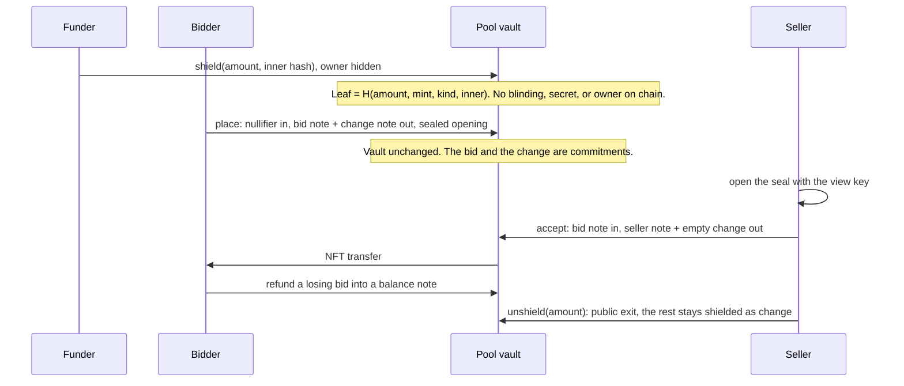

# pbid

Bids on a public NFT. A note bid hides its amount: the chain stores a commitment and a ciphertext only the seller can open. A legacy place still stores the amount in the clear and escrows that exact amount. This repository is separate from pescrow. The bidding program is not a pescrow instruction.

```
pbid/
├── README.md
├── Cargo.toml                Pinocchio program, host prover behind `host-proof`
├── src/                      program, circuit, Poseidon, note pool, prover jobs
├── tests/e2e.rs              the compiled program in LiteSVM, with a privacy scan
├── tests/note.rs             note pool transitions with real proofs
├── tests/job.rs              prover job refusals
├── tests/listing.rs          host tests for dispatch and refusals
├── tests/bid.rs              legacy clear bids
├── examples/bid_prove.rs     stdin/stdout wrapper around `pbid::job::run`
├── examples/gen_vk.rs        circuit setup: writes keys/pbid_pk.bin and src/vk.bin
├── examples/listing.md       account order for the list instruction
├── scripts/deploy-devnet.sh
└── keys/                     program keypair and proving key, gitignored
```

The devnet program id is `tkGNtSKLidw6evDw86n2VUieoJYmExXDXa4RgLdhjJq`. The desk that lists against this program lives in PrivacyStuff/website.

Listing locks the NFT with a standard-specific CPI, then marks the listing open. The list instruction is 42 bytes: tag, standard, deadline, and the seller's X25519 public key. Bidders encrypt the note opening to that key.

## Notes



The pool is one token account per mint, owned by the pool PDA (`["pool", mint]`). The pool account stores the Merkle frontier (depth 20) and the root. Every spend is a join-split with one input and two outputs, proved with Groth16 on BN254 and checked through `sol_alt_bn128_group_op`. Hashes are circom Poseidon through `sol_poseidon`, so the host prover and the program agree byte for byte. Each spent note is its own nullifier PDA (`["null", nullifier]`), and every field element on the wire has to be below the scalar modulus, so `n` and `n + r` cannot both be spent.

| Instruction | Data | Public | Hidden |
| --- | --- | --- | --- |
| shield (5) | amount, inner hash (41 B) | amount, funding wallet | owner, blinding, secret |
| place (1) | nullifier, bid, change, seal, proof | bidder wallet, listing | bid amount, change amount |
| accept (4) / refund (7) | nullifier, output, change, proof | signer, listing | amount |
| unshield (8) | nullifier, change, amount, proof | exit amount, wallet | what stays shielded |

The note bid account (`["bid", listing, bidder]`, 268 bytes) stores the bidder, the listing, the mint, the commitment, the Merkle index, and the 132-byte seal. A refunded slot takes a new bid. Accept and refund both require a locked bid. The bidder who locked a note can refund it while the listing is open, and a losing bidder can refund after a sale. The accepted note cannot be refunded.

`pbid::job::run` is the client contract. A job names an action, the pool root read from chain, the leaves replayed from instruction data, and the note it spends. It returns the instruction data and the openings of the notes it creates. It refuses a stale root, a note that is not in the tree, a note of the wrong kind or listing, and an amount outside the note before it proves anything.

What a chain observer can still learn: who bids on which listing, shield and unshield amounts and wallets, and timing. A note funded and owned by the same wallet bounds that wallet's bid by its shield, so fund from a separate wallet. Whoever runs the prover sees the note openings, so the prover belongs on the bidder's machine.

## Building and testing

```
cargo run --release --example gen_vk          # proving key and src/vk.bin, OS entropy
cargo-build-sbf --no-default-features --features bpf-entrypoint
cargo test --release
```

`gen_vk` is a single-party setup. Whoever ran it could forge proofs. A production deployment needs a multi-party ceremony that replaces `keys/pbid_pk.bin` and `src/vk.bin` together, then a program upgrade.

The main risk is the trusted setup: a leaked setup secret lets anyone mint notes out of the vault.

## NFT standards

The program stores one standard byte and dispatches a different CPI. These are not interchangeable accounts. Core collection plugins are a constraint on Core, not a sixth standard.

1. **Metaplex Core** (`CoREENxT6tW1HoK8ypY1SxRMZTcVPm7R94rH4PZNhX7d`). One asset account. Transfer uses `TransferV1` (discriminator 14). A freeze plugin blocks the listing only when its `frozen` byte is set. Royalties and transfer delegates do not. An external adapter still refuses the listing.
2. **Legacy SPL + Metaplex Token Metadata** (`metaqbxxUerdq28cj1RbAWkYQm3ybzjb6a8bt518x1s`). Mint supply 1, decimals 0, token amount 1, token standard `NonFungible`. The lock is an SPL transfer of 1 into a PDA associated token account.
3. **Programmable NFT**. Same metadata program, token standard `ProgrammableNonFungible`. Rejected at listing. A raw SPL transfer is not used.
4. **Token-2022 NFT** (`TokenzQdBNbLqP5VEhdkAS6EPFLC1PHnBqCXEpPxuEb`). `TransferChecked` of 1. A transfer hook or a permanent delegate refuses the listing.
5. **Compressed NFTs / Bubblegum** (`BGUMAp9Gq7iTEuizy4pqaxsTyUCBK68MDfK752saRPUY`). Rejected at listing. A token account is not treated as the leaf.
